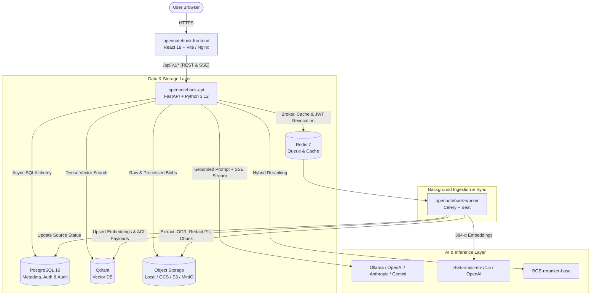

<p align="center">
  <h1 align="center">📓 OpenNotebook</h1>
  <p align="center">
    <strong>Your private, open-source AI research assistant & enterprise RAG platform.</strong><br>
    Ingest documents, run hybrid search, and stream grounded answers with inline citations — 100% local by default, cloud-ready when you need it.
  </p>
</p>

<p align="center">
  <a href="https://github.com/sarkarbikram90/OpenNoteBook/actions/workflows/ci.yml">
    
  </a>
  <a href="https://github.com/sarkarbikram90/OpenNoteBook/blob/main/LICENSE">
    
  </a>
  <a href="https://github.com/sarkarbikram90/OpenNoteBook/stargazers">
    
  </a>
  <a href="https://github.com/sarkarbikram90/OpenNoteBook/issues">
    
  </a>
  <a href="https://github.com/sarkarbikram90/OpenNoteBook/pulls">
    
  </a>
</p>

<p align="center">
  <a href="#-overview">Overview</a> •
  <a href="#-key-features">Key Features</a> •
  <a href="#-architecture">Architecture</a> •
  <a href="#-quick-start">Quick Start</a> •
  <a href="#-configuration">Configuration</a> •
  <a href="#-development--testing">Development</a> •
  <a href="#-deployment">Deployment</a> •
  <a href="#-roadmap">Roadmap</a>
</p>

---

## 📖 Overview

**OpenNotebook** is an open-source, privacy-first alternative to Google's NotebookLM designed for researchers, engineers, and enterprise teams. It transforms unstructured documents, web pages, images, and enterprise data sources into interactive, queryable notebooks.

By default, every stage of the pipeline—document parsing, OCR, PII redaction, semantic chunking, BGE vector embedding, cross-encoder reranking, and LLM inference via Ollama—runs **entirely on your infrastructure with zero data egress**. When cloud scale or proprietary frontier models are needed, OpenNotebook cleanly switches between local models and OpenAI, Anthropic, or Google Gemini, and deploys seamlessly to **Google Cloud Run** or **Kubernetes**.

### How OpenNotebook Compares

| Capability | OpenNotebook | NotebookLM |
|------------|:------------:|:----------:|
| **100% Local / Air-Gapped Execution** | ✅ | ❌ |
| **Open Source (MIT)** | ✅ | ❌ |
| **Pluggable LLMs** (Ollama, OpenAI, Anthropic, Gemini) | ✅ | ❌ |
| **Pluggable Object Storage** (Local, GCS, S3, MinIO) | ✅ | ❌ |
| **Hybrid Retrieval** (Dense Vector + BM25 + Cross-Encoder Reranking) | ✅ | — |
| **Real-Time SSE Streaming & Grounded Inline Citations** | ✅ | ✅ |
| **Automated PII Redaction & Security Guardrails** | ✅ | ❌ |
| **Enterprise Connectors & ACL Filtering** | ✅ | ❌ |
| **Extensible Extractor & Chunker Plugin System** | ✅ | ❌ |
| **Built-In RAG Evaluation & Observability Stack** | ✅ | ❌ |

---

## ✨ Key Features

- **Multi-Format Document Ingestion & OCR**
  - Upload **PDFs** (`PyMuPDF`), **Word documents** (`.docx`), **Markdown**, **Plain Text**, **Web URLs** (`trafilatura`), **YouTube video transcripts**, and **Raster Images** (`JPEG`, `PNG`, `WEBP`, `TIFF` via Tesseract OCR).
  - Content-addressable SHA-256 deduplication and asynchronous background processing with Celery workers and Dead Letter Queue (DLQ) recovery.

- **Precision Hybrid Retrieval Pipeline**
  - Recursive token-aware semantic chunking (default 800 tokens with 100-token overlap).
  - Combines **dense vector similarity** in **Qdrant** (`BAAI/bge-small-en-v1.5`) with **sparse lexical search** (**BM25**), fused and re-scored by a **cross-encoder reranker** (`BAAI/bge-reranker-base`).

- **Grounded Streaming Chat with Inline Citations**
  - Token-by-token responses streamed over **Server-Sent Events (SSE)**.
  - Interactive `[1]` citation chips map claims directly back to source passages, page numbers, and document sections.
  - Persistent multi-session chat history, automatic notebook summaries, and **Markdown / PDF export**.

- **Pluggable Models & Storage Backends**
  - **LLMs:** Local **Ollama** (`llama3:8b-instruct` default), **OpenAI**, **Anthropic Claude**, **Google Gemini**, plus a deterministic mock LLM stub for offline CI/testing.
  - **Embeddings:** Local HuggingFace/BGE embeddings on CPU/GPU or **OpenAI** embeddings.
  - **Object Storage:** Local filesystem (`local`), **Google Cloud Storage** (`gcs`), **Amazon S3** (`s3`), or **MinIO** (`minio`), tracked per source for safe multi-backend operation.

- **Enterprise Connectors, Governance & Security**
  - Built-in connector framework for **Confluence**, **SharePoint**, **Salesforce**, **Amazon S3**, **SQL databases**, **Local File Shares**, and **Generic REST APIs** with scheduled Celery Beat sync and ACL propagation.
  - Automated **PII detection and redaction** (regex & Presidio engines), prompt-injection guardrails, sensitivity classification, JWT authentication with Redis token revocation, and immutable audit logs.

- **Full-Stack Observability & RAG Evaluation**
  - Pre-wired **Prometheus** metrics, **Grafana** dashboards, **Loki + Promtail** log aggregation, **Celery Flower** task monitoring, and structured JSON logging.
  - Built-in **RAG evaluation harness** (`app.evaluation`) to benchmark retrieval recall, context precision, and answer groundedness.

---

## 🏗️ Architecture



### Repository Structure

```text
OpenNoteBook/
├── backend/                  # FastAPI application & RAG core (Python 3.12)
│   ├── app/
│   │   ├── api/v1/           # Thin REST & SSE route handlers + Pydantic v2 schemas
│   │   ├── core/             # Config, JWT auth, rate limiting, audit logs, Prometheus metrics
│   │   ├── domain/           # Core business logic: chat, retrieval, sources, connectors, governance
│   │   ├── evaluation/       # Automated RAG evaluation dataset, LLM judge, and metrics runner
│   │   ├── infrastructure/   # DB models, Qdrant, Redis, storage (Local/GCS/S3/MinIO), LLM providers
│   │   ├── plugins/          # Extensible extractor & chunker plugin interfaces
│   │   └── worker/           # Celery app, DLQ handler, source processing & sync tasks
│   ├── migrations/           # Alembic database migrations
│   └── tests/                # Unit, integration, and RAG evaluation regression suites
├── frontend/                 # React 19 + TypeScript + Tailwind CSS v4 + TanStack Query SPA
├── worker/                   # Celery worker container configuration
├── docs/                     # Architecture, local dev, GCS storage, plugins, and Cloud Run guides
├── helm/ & terraform/        # Kubernetes Helm charts and GCP Terraform infrastructure modules
├── grafana/ & prometheus/    # Pre-configured observability dashboards and scrape configs
└── docker-compose.yml        # Full local development & observability stack
```

---

## 🚀 Quick Start

### Prerequisites

- **Docker & Docker Compose v2**
- **8 GB RAM minimum** (16 GB recommended for local embeddings and Ollama inference; no GPU required)

### 1. Start the Stack

```bash
# Clone the repository
git clone https://github.com/sarkarbikram90/OpenNoteBook.git
cd OpenNoteBook

# Create your environment configuration
cp .env.example .env

# Launch all services in the background
docker compose up -d
```

### 2. Pull the Local LLM & Seed Demo Data (Optional)

If using the default local Ollama provider, pull the default instruct model and optionally seed a sample notebook:

```bash
# Pull the default local LLM into the Ollama container
docker compose exec ollama ollama pull llama3:8b-instruct

# Run database migrations and seed demo notebook + account
make db-upgrade
make seed
```

> [!TIP]
> **Default Seeded Demo Credentials:**
> - **Email:** `demo@example.com`
> - **Password:** `password123`
>
> You can also register a new account directly from the **Sign Up** tab at `http://localhost:5173/auth`.

### 3. Access Local Endpoints

| Service | URL | Notes |
|---------|-----|-------|
| **Web UI (Frontend)** | http://localhost:5173 | React 19 application |
| **API Docs (Swagger / OpenAPI)** | http://localhost:8000/docs | Interactive REST API explorer |
| **API Health Check** | http://localhost:8000/api/v1/health | Service readiness status |
| **Qdrant Dashboard** | http://localhost:6333/dashboard | Vector collection browser |
| **Celery Flower** | http://localhost:5555 | Background task monitor |
| **Grafana** | http://localhost:3000 | Dashboards (`admin` / `change-me`) |
| **Prometheus** | http://localhost:9090 | Metrics explorer |

---

## ⚙️ Configuration

All settings are managed via environment variables in `.env` (see [.env.example](.env.example) for the complete reference).

### Model Providers

OpenNotebook defaults to local inference (`LLM_PROVIDER=ollama`, `EMBEDDING_PROVIDER=local`). To use cloud APIs, set the provider in `.env`:

```dotenv
# LLM Provider: ollama | openai | anthropic | gemini
LLM_PROVIDER=ollama
OLLAMA_MODEL=llama3:8b-instruct

# Optional Cloud LLM keys
OPENAI_API_KEY=
OPENAI_MODEL=gpt-4o-mini
ANTHROPIC_API_KEY=
ANTHROPIC_MODEL=claude-3-5-sonnet-latest
GEMINI_API_KEY=
GEMINI_MODEL=gemini-1.5-flash

# Embedding & Reranker Models
EMBEDDING_PROVIDER=local          # local | openai
EMBEDDING_MODEL=BAAI/bge-small-en-v1.5
RERANKER_MODEL=BAAI/bge-reranker-base
```

### Object Storage Providers

Choose where uploaded source documents and extracted text artifacts are stored:

```dotenv
# Storage Provider: local | gcs | s3 | minio
STORAGE_PROVIDER=local

# Google Cloud Storage (when STORAGE_PROVIDER=gcs)
GCS_BUCKET=your-private-bucket-name
GCS_PROJECT_ID=your-gcp-project-id
GCS_TIMEOUT_SECONDS=60
```

For local container development against a private Google Cloud Storage bucket using Application Default Credentials (ADC), use the included Compose override:

```bash
gcloud auth application-default login
export GOOGLE_APPLICATION_CREDENTIALS_HOST="$HOME/.config/gcloud/application_default_credentials.json"
docker compose -f docker-compose.yml -f docker-compose.gcs.yml up -d --build
```

See [docs/gcs-storage.md](docs/gcs-storage.md) for full details.

---

## 🛠️ Development & Testing

Common workflows are automated via the project [Makefile](Makefile):

```bash
make dev              # Build and start all services with hot reload
make logs             # Tail logs across all containers
make worker-logs      # Tail Celery worker output
make db-upgrade       # Apply Alembic database migrations
make seed             # Populate demo user, notebook, and sources
make lint             # Run ruff, mypy, and eslint
make format           # Format backend code with ruff
make test             # Run backend pytest suite + frontend Vitest suite
make clean            # Stop containers and remove volumes
```

### Running Tests Direct on Host

```bash
# Backend unit & evaluation regression tests
cd backend
pytest tests/evaluation tests/unit -o addopts="" -q

# Backend linting & strict type checking
ruff check app/
mypy app/

# Frontend unit tests, type checking, and lint
cd ../frontend
npm test -- --run
npm run typecheck
npm run lint
```

For step-by-step host setup outside Docker, see [docs/local-dev.md](docs/local-dev.md).

---

## ☁️ Deployment

OpenNotebook supports both serverless cloud deployment and Kubernetes orchestration:

1. **Google Cloud Run (Serverless Production):**
   - **Services:** `opennotebook-api` (FastAPI/Uvicorn) and `opennotebook-frontend` (Nginx SPA + dynamic reverse proxy).
   - **Registry:** Google Artifact Registry (`us-central1-docker.pkg.dev`).
   - **CI/CD:** Automated GitHub Actions pipeline (`.github/workflows/deploy.yml`) using keyless **Workload Identity Federation (WIF)**.
   - Full walkthrough: [docs/production-deploy.md](docs/production-deploy.md)

2. **Kubernetes & Terraform (Self-Hosted / Enterprise Cloud):**
   - Production Helm charts in [`helm/opennotebook/`](helm/opennotebook) (`make deploy`).
   - GCP infrastructure-as-code modules in [`terraform/`](terraform).

---

## 📚 Documentation

- **[Architecture Guide](docs/architecture.md)** — System topology, sequence diagrams, and design decisions
- **[Local Development Guide](docs/local-dev.md)** — Workstation setup, virtual environments, and troubleshooting
- **[Production Deployment Guide](docs/production-deploy.md)** — GCP Cloud Run, Artifact Registry, and Workload Identity Federation setup
- **[Google Cloud Storage Guide](docs/gcs-storage.md)** — Private GCS bucket provisioning, IAM roles, and ADC configuration
- **[Plugin Guide](docs/plugin-guide.md)** — Authoring custom document extractors and semantic chunkers
- **[Contributing Guide](docs/contributing.md)** — Development workflow, code standards, and pull request guidelines

---

## 🗺️ Roadmap

### Phase 1 — Core Platform & Enterprise Foundation (Completed)

- [x] Notebook & multi-session conversation management
- [x] Multi-format source ingestion (PDF, DOCX, TXT, Markdown, Web URLs, YouTube transcripts)
- [x] Raster image ingestion with Tesseract OCR (`JPEG`, `PNG`, `WEBP`, `TIFF`)
- [x] Pluggable object storage (`local`, `gcs`, `s3`, `minio`)
- [x] Token-aware semantic chunking + local BGE embeddings (`BAAI/bge-small-en-v1.5`)
- [x] Hybrid retrieval (Qdrant dense vectors + BM25 lexical search + cross-encoder reranking)
- [x] Real-time SSE streaming answers with interactive inline citations
- [x] Pluggable LLM & embedding provider abstraction (`ollama`, `openai`, `anthropic`, `gemini`)
- [x] Enterprise connectors (Confluence, SharePoint, Salesforce, S3, SQL, REST) with ACL filtering
- [x] Automated PII redaction, guardrails, audit logging, and RAG evaluation suite
- [x] Notebook export (Markdown / PDF)
- [x] Production GCP Cloud Run CI/CD with keyless Workload Identity Federation

### Phase 2 — Multimodal & Collaborative Intelligence (In Progress)

- [ ] Audio overviews & podcast-style two-host dialogue generation (TTS)
- [ ] Multimodal vision embeddings & diagram/chart understanding (Gemini / Vertex AI Vision)
- [ ] Event-driven GCS Pub/Sub bucket ingestion for external pipelines
- [ ] Interactive knowledge graph visualization & GraphRAG traversal
- [ ] Multi-user collaborative workspaces & fine-grained RBAC UI
- [ ] Community plugin & connector marketplace

---

## 📄 License

Distributed under the **MIT License**. See [LICENSE](LICENSE) for details.

---

## ⭐ Support

If you find **OpenNotebook** useful for your research or engineering workflows, please consider giving the repository a ⭐ on GitHub!
