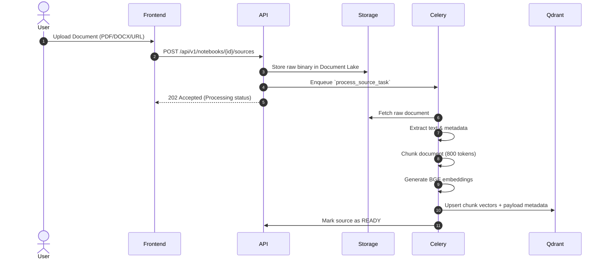
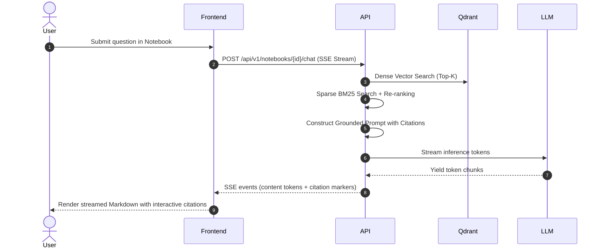

# OpenNotebook — System Architecture

This document outlines the architecture, data flows, and design decisions of the **OpenNotebook** private AI research assistant.

---

## 1. System Overview

OpenNotebook is an open-source, private, and local-first AI research assistant designed as an enterprise-grade alternative to NotebookLM. It ingests diverse unstructured documents, extracts clean text, computes semantic embeddings, performs hybrid vector + lexical retrieval, and streams answers with inline citations.

```mermaid
flowchart TD
    User([User Browser]) -->|HTTPS| Frontend[opennotebook-frontend\nReact 19 + Nginx\nCloud Run]
    Frontend -->|/api/* (Reverse Proxy)| API[opennotebook-api\nFastAPI (Python 3.12)\nCloud Run]
    
    subgraph Data & Storage
        API -->|Async ORM| DB[(PostgreSQL 16\nMetadata & State)]
        API -->|Vector Search| Qdrant[(Qdrant\nVector DB)]
        API -->|Blob Storage| Storage[(MinIO / Cloud Storage\nDocument Lake)]
        API -->|Task Dispatch| Redis[(Redis 7\nQueue & Cache)]
    end

    subgraph Background Processing
        Redis --> Worker[opennotebook-worker\nCelery Tasks]
        Worker --> DB
        Worker --> Qdrant
        Worker --> Storage
    end

    subgraph AI & Inference
        API -->|Prompts & Inference| Ollama[Ollama / Pluggable LLM]
        Worker -->|Embeddings| BGE[BGE-small-en-v1.5 / Reranker]
    end
```

---

## 2. Component Breakdown

### 2.1 Frontend (`frontend/`)
* **Technology:** React 19, TypeScript, Vite, Tailwind CSS v4, TanStack Query & Router.
* **Serving:** Multi-stage Docker image using `nginx:alpine`.
* **Cloud Run Portability:** Container entrypoint dynamically adapts to Cloud Run's `$PORT` environment variable and dynamically rewrites upstream `/api/` proxy pass targets to the live Cloud Run backend URL with `proxy_ssl_server_name on;` and `$proxy_host`.

### 2.2 API Layer (`backend/app/api/`)
* **Technology:** FastAPI, Python 3.12, Uvicorn, Pydantic v2.
* **Key Features:**
  * Thin route handlers delegating to domain services.
  * Real-time Server-Sent Events (SSE) streaming for chat responses.
  * Grounded inline citations with source document references.
  * JWT authentication with token revocation via Redis.
  * Structured JSON logging and OpenTelemetry instrumentation.

### 2.3 Domain Services (`backend/app/domain/`)
* **Chat Service:** Orchestrates context compilation, conversation history, and LLM streaming.
* **Retrieval Service:** Implements hybrid retrieval combining dense vector similarity (Qdrant) and sparse lexical search (BM25), followed by cross-encoder re-ranking.
* **Sources & Connectors:** Extensible ingestion pipeline supporting PDFs, DOCX, Markdown, plain text, web pages, and YouTube transcripts.
* **Chunking & Embedding:** Semantic chunking (800 tokens, 100 token overlap) with local BGE embeddings.

### 2.4 Infrastructure & Storage (`backend/app/infrastructure/`)
* **PostgreSQL 16:** Stores notebooks, sources, users, workspaces, chat history, and immutable audit logs.
* **Qdrant:** High-performance vector database indexing document chunks with payload filtering for tenant and workspace isolation.
* **MinIO / S3:** Object storage holding raw uploaded artifacts.
* **Redis 7:** Broker for Celery tasks, rate-limiting counters, and revoked JWT cache.

---

## 3. Data Flow

### 3.1 Document Ingestion Flow


### 3.2 Query & Grounded Answer Flow


---

## 4. Key Design Decisions

1. **No Data Egress / Local-First by Default:** Standard deployment relies on local embedding models and Ollama, ensuring zero document content leaves the private environment.
2. **Pluggable Architecture:** Embedding and LLM layers implement unified interfaces, permitting enterprise extensions to Google Cloud Vertex AI, OpenAI, or Anthropic where approved.
3. **Containerized Portability:** Works identically across local Docker Compose (`docker compose up`), Google Cloud Run serverless microservices, and Kubernetes/Helm.
4. **Resilient Security:** JWT authentication with Redis-backed revocation, audit trails, and Workload Identity Federation (WIF) keyless deployment.
